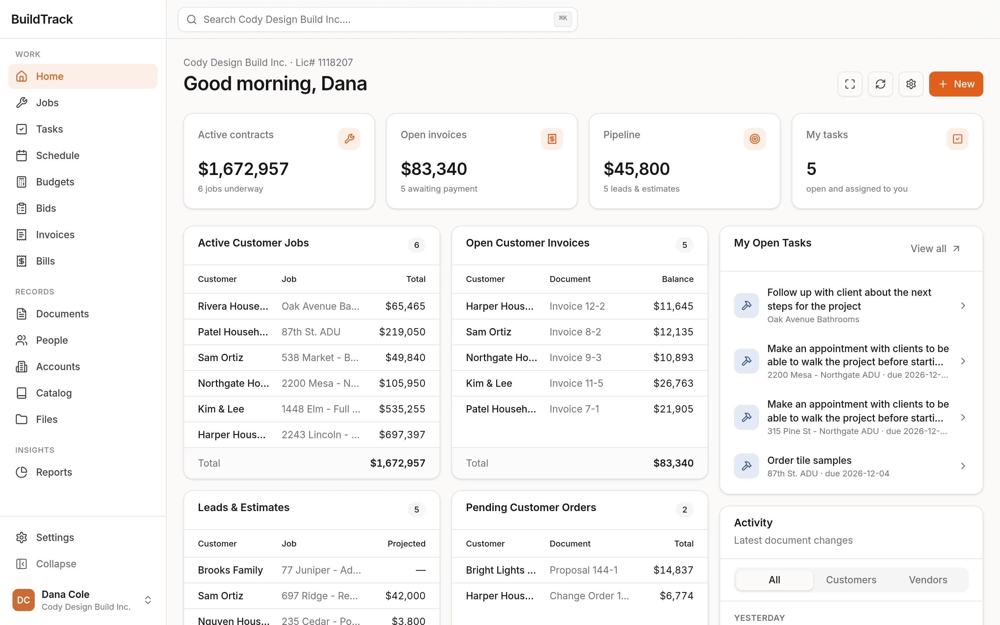
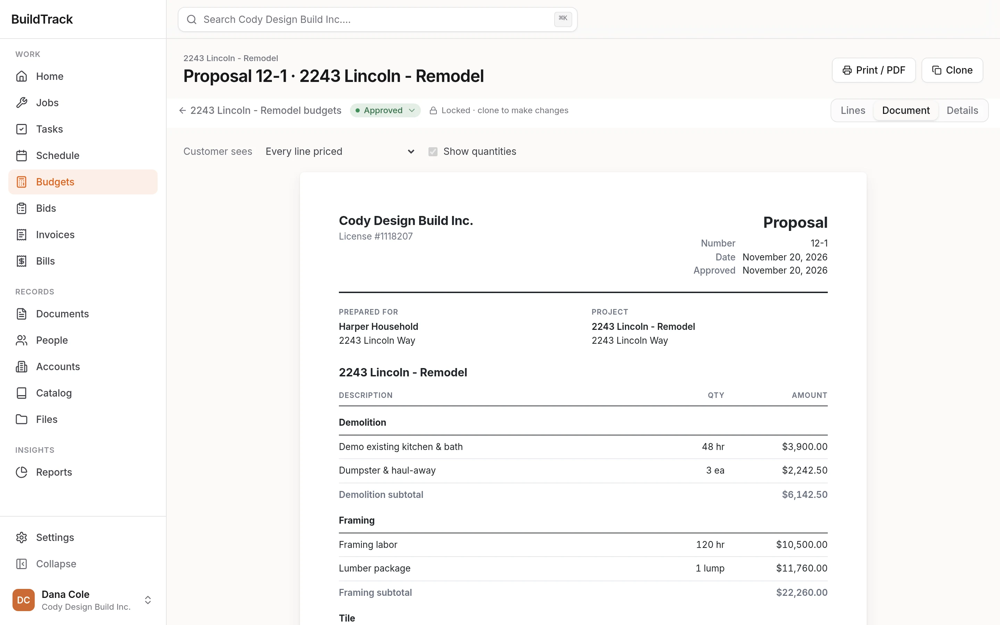
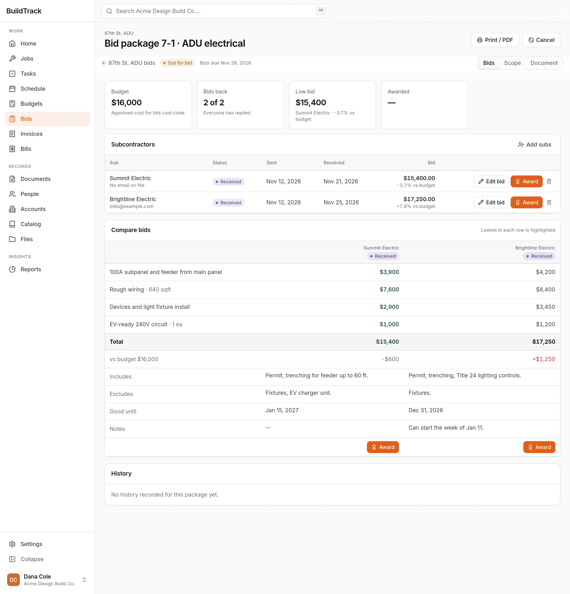
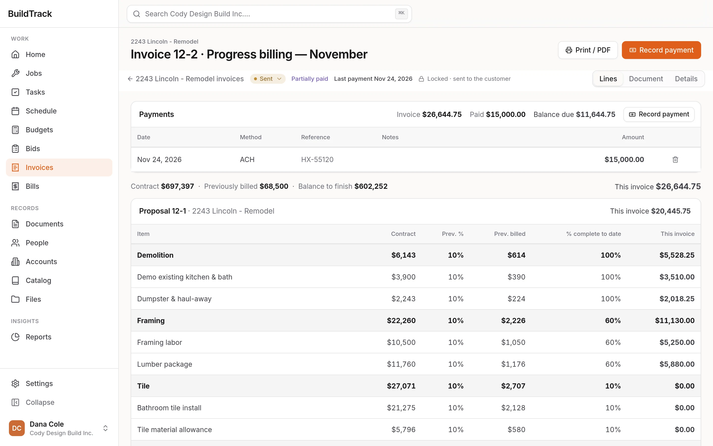
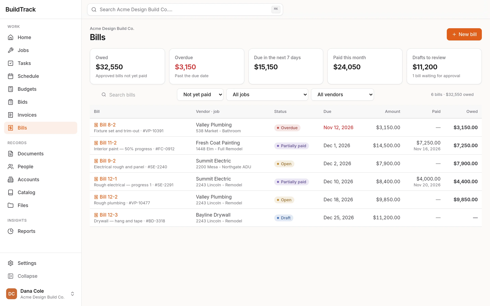
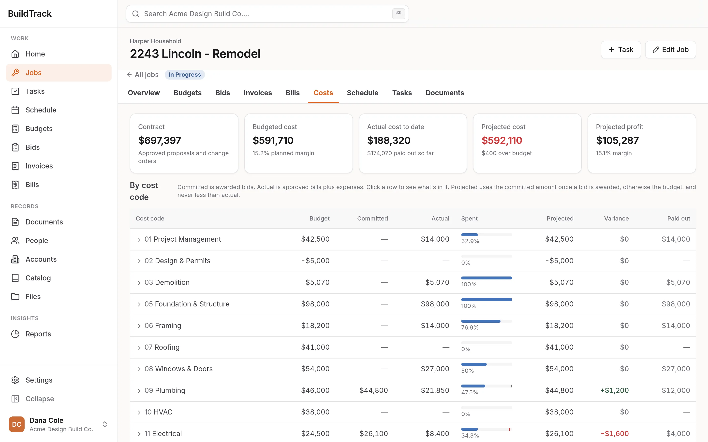
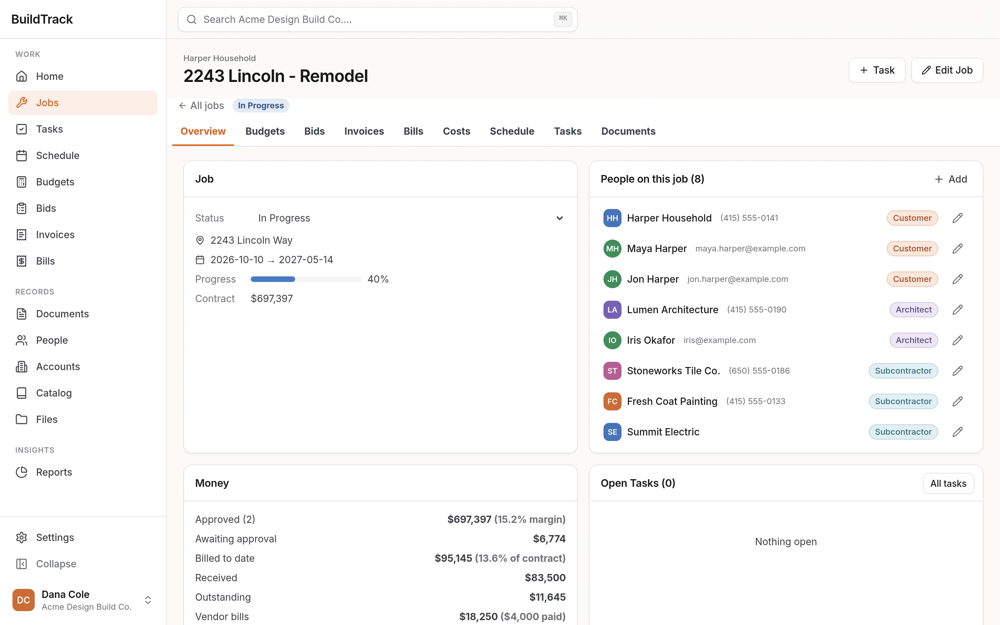
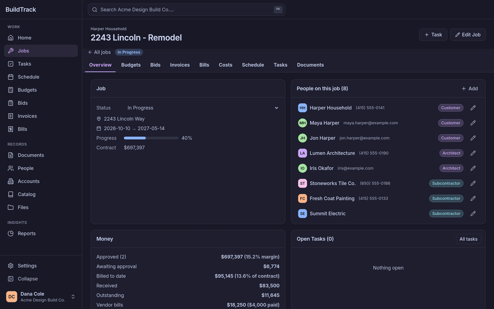

<h1 align="center">BuildTrack</h1>

<p align="center"><b>Job management for design-build contractors, built by one.</b><br>
Proposals, change orders, bids, invoices, bills and job costing, kept in one place and tied to the job.<br>
<a href="https://buildtrack.run">buildtrack.run</a></p>

<p align="center"></p>

---

Most construction software was designed years ago around how *someone else* runs a job, and you end up working the way the software works. BuildTrack was built inside a working design-build company to follow how jobs actually go:

1. You price the work.
2. The customer signs.
3. Subs bid on the scope.
4. You bill as the work gets done.
5. You pay the subs and see what the job really made.

Every step feeds the next, so nothing gets typed twice.

## What it does

### Proposals and change orders your customer can read

Each proposal and change order is its own document, with line items, cost codes, cost, markup and price. The customer sees a clean document with your prices, never your costs. You choose how much detail they get: every line, group totals or one number. Print it or save it as a PDF.

Once a proposal is sent it's locked, so it always matches what the customer saw. When it's approved, BuildTrack records who signed and when, and keeps the signed copy. Change orders show what was already approved and the new contract total.

<p align="center"></p>

### Bids from your subs, compared side by side

Put a piece of the job out to bid. Write the scope, list the items to price (or copy them from the proposal), and attach plans and specs. Send it by email; your subs don't need another login or portal.

Enter each bid as it comes back. BuildTrack lines them up item by item, highlights the lowest price in each row, and compares each one with what you budgeted. **Award** a bid and its first bill is drafted for you.

<p align="center"></p>

### Progress invoices that do the maths

Bill against the approved proposal and change orders by percent complete, line by line or a whole section at once. BuildTrack works out:

- this invoice's amount;
- what was billed before;
- the balance to finish.

Sent invoices lock so their numbers never move. Record payments as they come in, and see what's outstanding and overdue across every job.

<p align="center"></p>

### Bills and payments to vendors

Enter what you owe subs and suppliers from their invoices, with each charge coded to a cost code. Approve bills before they're paid, record each payment (check, ACH, card), and see:

- what's owed;
- what's overdue;
- what's due this week.

Attach the vendor's invoice or lien release to the bill.

<p align="center"></p>

### Job costing that updates itself

Every job has a **Costs** tab with one row per cost code, filled in automatically from the rest of BuildTrack:

| Column | Where it comes from |
|---|---|
| **Budget** | Your approved proposals and change orders, at cost |
| **Committed** | Bids you've awarded |
| **Actual** | Approved vendor bills and expenses |
| **Projected** | The best guess at the final cost, with variance and projected profit |

You see a cost code going over while there's still time to do something about it, not after the job closes.

<p align="center"></p>

### Everything about a job in one place

A job's page holds:

- the customer, the architect and every sub on it;
- its proposals, bids, invoices, bills, costs, schedule, tasks and documents.

The Overview gives the money at a glance:

- approved contract and margin;
- billed, received and outstanding;
- owed to vendors;
- cost to date and projected profit.

<p align="center"></p>

### And the rest of the day-to-day

- **Home dashboard**: active contracts, open invoices, your pipeline and what needs doing today.
- **Schedule**: every job and crew on a Gantt chart or a list, which you can export to your calendar.
- **Tasks**: to-dos for the team, by type, due date and assignee, also exportable to your calendar.
- **Contacts**: people and companies (households, architects, subs, suppliers), each linked to the jobs they're on, with their bids and bills.
- **Your team**: invite people by email as owners, admins or members; everyone works on the same live data, sees changes as they're saved, and opens the same signed copies and attachments.
- **Your look**: light and dark mode, the BuildTrack and Omarchy themes (or import your own), custom colours, accent, font and corners, saved presets, and a company theme everyone starts on. Customer documents always print black on white.

<p align="center"></p>

### Make it yours

Every feature (budgets, bids, invoices, bills, job costing, the schedule, tasks) is a module. Turn off what you don't use in **Settings → Plugins**, and the menu, the job tabs and the pages go with it. Your data is kept for when you turn it back on.

Don't like how a module works? Change that module or replace it, without touching the rest of BuildTrack. Modules share data through small, documented contracts. For example, job costing adds up cost entries from budgets, bids and bills, so a new job-costing module works with all of them. See [`src/plugins/README.md`](src/plugins/README.md).

## Built for how contractors actually work

- **Email first, no portals.** Bid requests, proposals and invoices are documents you send the way you already do, and nobody needs an account to read them.
- **Numbers that don't move.** Sent proposals and invoices lock. To change one, clone it, so there's always a record of what was agreed.
- **Your cost, their price.** Cost and markup stay on your side; the customer sees prices.
- **Cost codes everywhere.** Proposals, bids, bills and expenses all use the same cost codes, which is what makes job costing automatic.

## Built for the agentic era

BuildTrack is meant to be changed, by you or by an AI coding agent such as Claude Code or Codex. Describe what your company needs in plain words; the agent makes the change and you check it before your team sees it.

- **[AGENTS.md](AGENTS.md)** walks any agent through the code, the data and the release process.
- **One simple data model.** Every record is a row; a new kind of record needs no database migration.
- **Every change gets a preview.** Pull requests build a private preview with sample data before anything goes live.
- **Small enough to read.** React and TypeScript, no framework maze.

## Status

**BuildTrack is an internal tool at Cody Design Build.** It isn't open to the public. There's no sign-up, and every account starts with an invite (see [Accounts, sign-in and email](docs/accounts-and-email.md)). The team uses it with shared live data: sign-in by emailed code or company Google account, changes appear on everyone's screen as they're saved, and signed copies and attachments are shared.

The code is public under the AGPL. Running your own copy is possible ([Run BuildTrack for your team](docs/self-hosting.md)), but it isn't supported yet. A hosted version for other companies may come later.

## Try it

**In your browser:** [demo.buildtrack.run](https://demo.buildtrack.run) runs BuildTrack on sample data, saved only in your browser. Nothing you do there is shared or sent anywhere.

**On your computer:**

```
npm install
npm run dev
```

Then open http://localhost:5173. Sample jobs, customers, subs, proposals, invoices, bids and bills are already loaded, saved in your browser. Use **Settings → Reset sample data** to start over.

Running it for a whole team, with shared live data and invite-only sign-in on your own Supabase and Vercel accounts, is described in **[Run BuildTrack for your team](docs/self-hosting.md)**. That isn't supported yet.

## Learn more

- [How BuildTrack works](docs/guide.md): the rules behind budgets, invoices, bids, bills and job costing.
- [Developing BuildTrack](docs/development.md): building, themes, and where the code and data live.
- [Accounts, sign-in and email](docs/accounts-and-email.md): invites, sign-in codes, Resend and what to check when a code doesn't arrive.
- [Run BuildTrack for your team](docs/self-hosting.md): Supabase, sign-in, email and Vercel (unsupported for now).
- [AGENTS.md](AGENTS.md): the workflow for people and AI agents changing BuildTrack.

## Licence

BuildTrack is free software under the [GNU Affero General Public License v3.0](LICENSE) (AGPL-3.0). You can use it, change it and run it for your own company at no cost. If you run a modified version as a service for other people, you must make your changes available to them under the same licence.

Copyright © 2026 Cody Design Build Inc.

